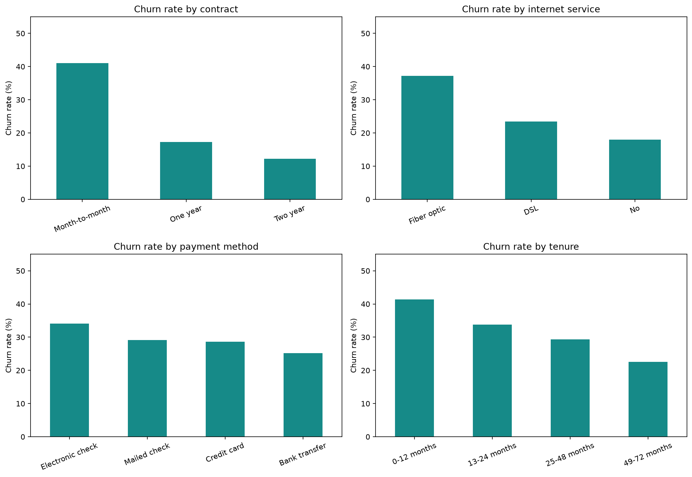

# Telecom Customer Churn Analytics

**Portfolio project | Python · MySQL · Power BI**

Analyze which telecom customer segments are associated with churn, quantify revenue exposure, and propose retention experiments. The dataset is **synthetic and generated for learning**, not real telecom customer records.

## Executive snapshot

| KPI | Value |
|---|---:|
| Customers | 3,000 |
| Churned customers | 893 |
| Churn rate | 29.77% |
| Monthly revenue (sample) | $189,919.17 |
| Monthly revenue associated with churn | $60,343.19 |

## Project structure
```text
data/           Synthetic customer CSV and validated KPI summary
src/            Python exploratory analysis
sql/            MySQL schema and business queries
dashboard/      Power BI dashboard build instructions
visualizations/ Python analysis chart; add PBIX screenshot after building
docs/           Business insights and recommendations
requirements.txt
```

## How to run
1. Create a virtual environment: `python -m venv .venv`
2. Activate it on Windows: `.venv\Scripts\activate`
3. Install packages: `pip install -r requirements.txt`
4. Run: `python src/analyze_churn.py`
5. For SQL, execute `sql/01_create_database.sql`, import the CSV into `telecom_churn.customers` using MySQL Workbench, then execute `sql/02_business_queries.sql`.
6. For Power BI, follow `dashboard/POWER_BI_BUILD_GUIDE.md`.

## Analysis questions
- How does churn rate vary by contract type, tenure, and payment method?
- Which segments contribute the most to churn-associated monthly revenue?
- How might retention experiments target at-risk segments?

## Visualizations


## Limitations
Synthetic, cross-sectional observations. No causal inference, predictive model, or actual future churn forecasting is claimed. Dashboard `.pbix` must be built in Power BI Desktop.
